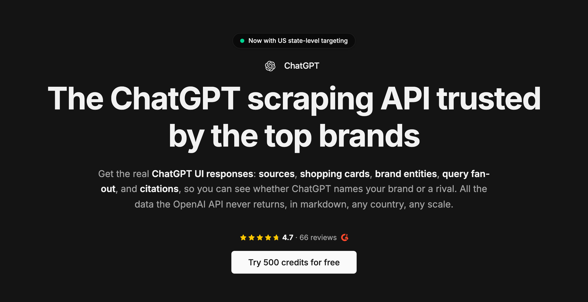

# ChatGPT Scraper

[](https://cloro.dev/chatgpt/?utm_source=github)

[](https://cloro.dev/)

The [ChatGPT scraper](https://cloro.dev/chatgpt/?utm_source=github) by cloro gets ChatGPT responses programmatically, without the OpenAI API. It returns what ChatGPT's web interface shows a logged-out visitor, as structured JSON: answer text, cited sources and citation pills. Optional extras are Markdown, shopping cards, inline products, ads and the query fan-out terms behind the answer.

## How do you scrape ChatGPT?

1. Get an API key at [cloro.dev](https://cloro.dev/?utm_source=github&utm_medium=readme).
2. POST a prompt to `https://api.cloro.dev/v1/monitor/chatgpt`.
3. Read the parsed fields from the JSON response.

The official OpenAI API is the wrong surface for brand monitoring, because the pages it cites differ from the ones ChatGPT's web UI shows its users. Reading that UI means getting past Cloudflare JA4 TLS fingerprinting and Turnstile, assembling a Server-Sent Events stream, and tracking CSS class names that change between deploys. cloro handles all of it server-side.

### Request sample (Python)

```python
import requests

payload = {
    'prompt': 'best project management software for remote teams',
    'country': 'US',
    'include': {'markdown': True, 'searchQueries': True},
}

response = requests.post(
    'https://api.cloro.dev/v1/monitor/chatgpt',
    headers={'Authorization': 'Bearer YOUR_API_KEY'},
    json=payload,
)

print(response.json())
```

### Request sample (cURL)

```bash
curl -X POST https://api.cloro.dev/v1/monitor/chatgpt \
  -H "Authorization: Bearer YOUR_API_KEY" \
  -H "Content-Type: application/json" \
  -d '{"prompt": "best running shoes for flat feet", "country": "US", "include": {"shopping": true}}'
```

Node.js and async/webhook examples are in the [endpoint documentation](https://cloro.dev/docs/api-reference/endpoint/monitor-chatgpt).

### Request parameters

| Parameter | Description | Default |
| --- | --- | --- |
| `prompt`\* | The query or question (1-10,000 characters), or an array of up to 5 for a [multi-turn conversation](https://cloro.dev/docs/api-reference/endpoint/monitor-chatgpt#multi-turn-conversations) (`result` is then an array) | – |
| `country`\* | Country code for localized results (`US`, `GB`, `DE`) | – |
| `state` | US state code for finer localization | – |
| `include.markdown` | Return the answer as Markdown | `false` |
| `include.html` | Return a URL to the full HTML (expires after 24h) | `false` |
| `include.rawResponse` | Return the unparsed upstream payload | `false` |
| `include.searchQueries` | Return the query fan-out terms ChatGPT searched | `false` |
| `include.shopping` | Return shopping cards and inline products | `false` |
| `include.ads` | Return sponsored blocks | `false` |
| `disableWebSearch` | Return the answer ChatGPT gives on its own instead of forcing a web search | `false` |

\* Required

## What data does the ChatGPT scraper return?

```json
{
  "success": true,
  "result": {
    "text": "For remote teams, the strongest options are...",
    "citationPills": [{ "citationPillId": 0, "label": "Asana", "url": "https://asana.com", "domain": "asana.com" }],
    "searchQueries": ["best project management software 2026", "asana vs monday remote teams"],
    "markdown": "For remote teams, the strongest options are **Asana**..."
  }
}
```

Alongside `text` and `markdown`:

1. **`sources`**: every cited URL with position, label and description.
2. **`citationPills`**: the inline citation chips, one entry per cited source, sharing a `citationPillId` when a pill cites several.
3. **`entities`**: the products, brands and concepts the answer names, each with a type.
4. **`searchQueries`**: the query fan-out. ChatGPT decomposes one prompt into several searches, and these are the terms it actually ran, which is the clearest signal of how it read the question. It comes back empty on ChatGPT's default mobile-web interface; `legacy: true` asks for the legacy interface that returns it, on a best-effort basis ([why](https://cloro.dev/docs/api-reference/endpoint/monitor-chatgpt)).
5. **`shoppingCards`**: product carousels, each grouping `products[]` with their price and merchant offers ([schema](https://cloro.dev/docs/api-reference/endpoint/chatgpt/shopping-cards)).
6. **`inlineProducts`**: products embedded in the answer text, separate from the carousels.
7. **`ads`**: sponsored blocks, parsed. ChatGPT currently shows them only in answers to a follow-up prompt, and far more often on the legacy interface: send `prompt` as an array with `legacy: true` ([details](https://cloro.dev/docs/api-reference/endpoint/chatgpt/ads)).
8. **`map`**: business and location entries with rating, reviews and address.
9. **`rawResponse`**: the unparsed upstream payload, when you want to parse it yourself.
10. **`followUpForm`**: the form ChatGPT shows to refine the prompt: its questions, their options and the follow-up prompt it would send ([schema](https://cloro.dev/docs/api-reference/endpoint/chatgpt/follow-up-form)). `null` when the answer has no form.

Full field-level schemas are in the [endpoint reference](https://cloro.dev/docs/api-reference/endpoint/monitor-chatgpt).

## Use cases

- **Brand monitoring**: whether ChatGPT names you, and which sources it cites when it does.
- **Competitive intelligence**: who else is named on the prompts your buyers ask.
- **Shopping and commerce**: track how products surface in ChatGPT's shopping cards.
- **Query fan-out research**: see the sub-queries behind an answer, which is what you can actually optimize for.

## FAQ

### Why not use the official OpenAI API?

With its web search tool it searches and cites sources, but it cites a different set of pages than ChatGPT shows its users. cloro reads ChatGPT's web interface in a real browser session, the surface users see.

### Playwright or a paid API for scraping AI chat answers?

With Playwright you run the browser sessions, proxies, retries and parsing yourself. cloro runs them behind one API call: [a real browser session](https://cloro.dev/docs/guides/providers#how-does-cloro-retrieve-data-from-ai-providers) on ChatGPT's web interface through a proxy in the country you set, up to 5 attempts, and JSON back. You pay only for results. It also returns Gemini, Google AI Mode and AI Overview answers.

### Is scraping ChatGPT allowed?

cloro reads publicly visible responses from its own sessions. Do not use it to access other users' conversations or private data, and check your own jurisdiction and terms.

### Can I extract ChatGPT shopping results and product recommendations?

Yes. Set `include.shopping: true`. ChatGPT's current model shows products as cards in the answer, and they come back in `inlineProducts` with title, price, description, images, offers and the citations behind each product. Add `include.productDetails: true` for the rationale and reviews. Shopping is a +2 credit add-on; product details add +2 more. Older models also fill `shoppingCards`.

### How often do the selectors break?

OpenAI ships UI changes roughly weekly, and dynamic CSS class names change between deploys. That maintenance is the point of a managed endpoint; a DIY scraper returns empty results rather than errors when it breaks, so alert on success rate rather than exceptions.

### What is the recommended timeout?

At least 5 minutes (300 seconds), because cloro retries failed attempts server-side before it answers ([retries and cancellation](https://cloro.dev/docs/guides/error-handling#retries-and-cancellation)). Use the async endpoint for batches.

## Learn more

- **Endpoint reference:** [cloro.dev/docs](https://cloro.dev/docs/api-reference/endpoint/monitor-chatgpt)
- **Product page:** [cloro.dev/chatgpt](https://cloro.dev/chatgpt/)

## Other cloro scrapers

[AI Mode](https://cloro.dev/ai-mode/) · [AI Overview](https://cloro.dev/ai-overview/) · [Bing AI Mode](https://cloro.dev/bing-ai-mode/) · [Gemini](https://cloro.dev/gemini/) · [Google Search](https://cloro.dev/google-search/) · [Google News](https://cloro.dev/google-news/)

## Contact us

Questions or support: [ask the docs AI assistant](https://cloro.dev/docs/?assistant).
